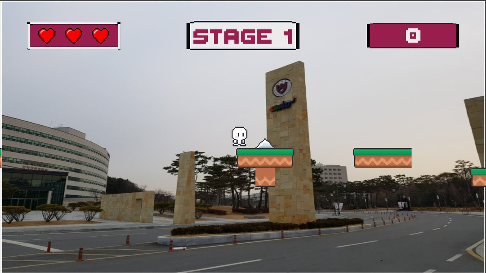
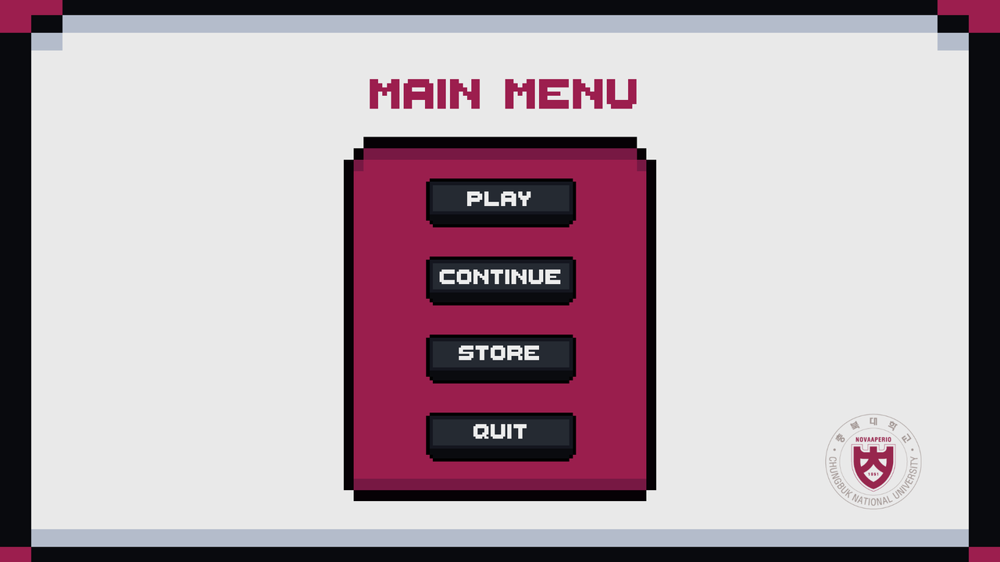
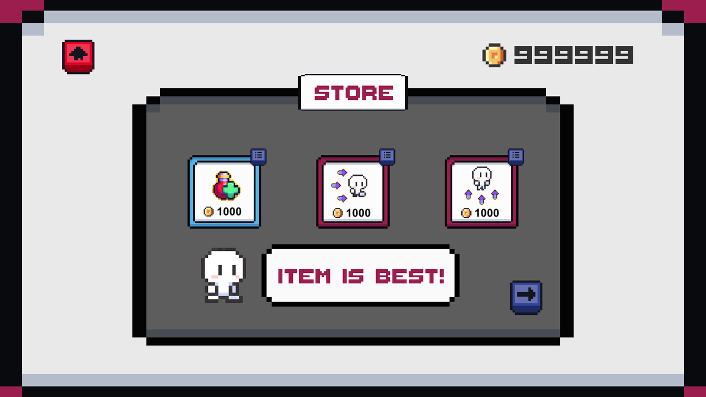
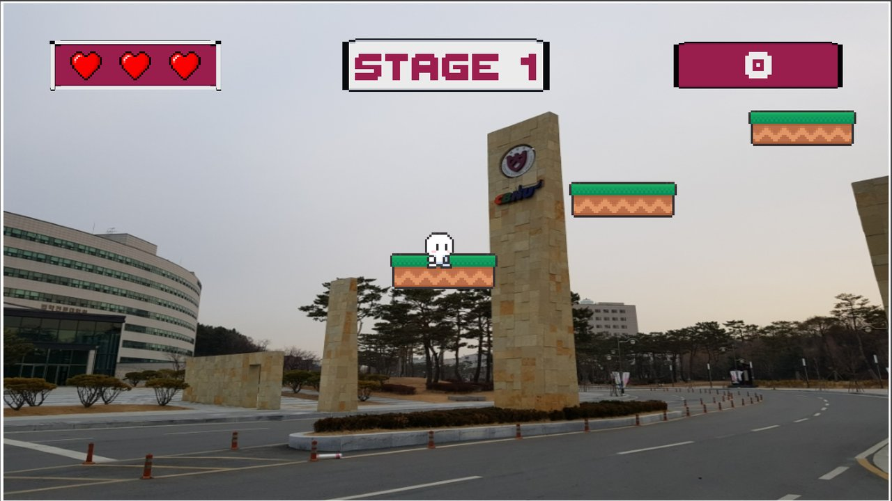
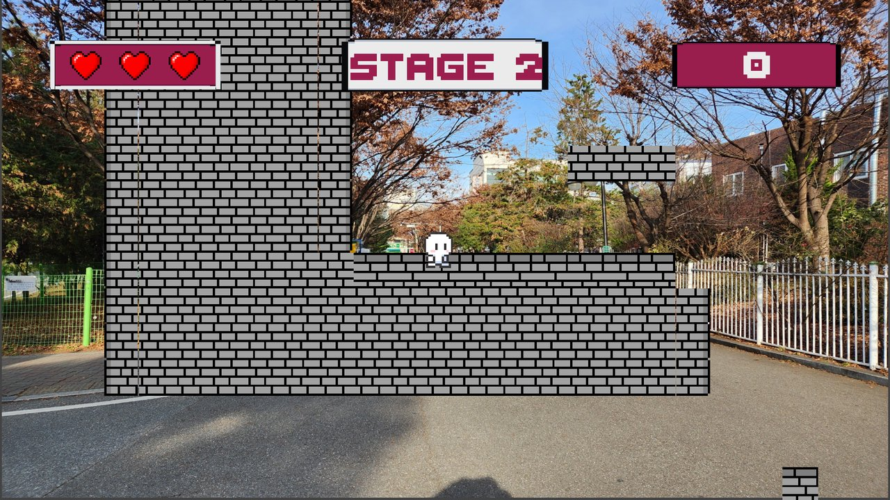

# CBNU Jump Action

A **Unity 2D platformer** where you run and jump across the Chungbuk National University campus.
Team project for the CBNU Open Source Software course (Nov 2022 – Dec 2022)

<p align="center">
  
</p>

## Overview

A side-scrolling jump action game that uses real photos of Chungbuk National University's **Main Gate** and **Middle Gate** as stage backgrounds.
The player crosses platforms, collects coins, and stomps on enemies to reach the finish flag.
Coins can be spent in the shop to upgrade stats or buy a new character (school uniform character).

## Features

| Category | Description |
| --- | --- |
| **Stages** | Two stages, Main Gate → Middle Gate; reaching the goal moves to the next stage |
| **Player** | Movement, jumping, animations (idle/walk/jump/hit), stomp attack on enemies, knockback and 2 seconds of invincibility when hit |
| **Health system** | Heart UI; decreases on falling, spikes, or enemy contact; Retry when all hearts are lost |
| **Coins & score** | Gold (200), silver (100), and bronze (50) coins; 100 points per enemy defeated |
| **Shop** | Movement speed upgrade, jump power upgrade, new character purchase (+1 health, dedicated UI) |
| **Gimmick platforms** | Falling platforms (restored after a delay), platforms moving up and down, flying platforms that rise when stepped on, incoming cannonballs |
| **Enemy AI** | Picks a random movement direction and turns around at cliffs using raycast detection |
| **Sound** | Sound effects for jump, attack, hit, coin, death, clear, and purchase |

## Screenshots

| Main Menu | Shop |
| :---: | :---: |
|  |  |
| **Stage 1 · Main Gate** | **Stage 2 · Middle Gate** |
|  |  |

## Controls

| Key | Action |
| --- | --- |
| ← / → | Move |
| Space | Jump |
| Land on an enemy | Attack |

## Tech Stack & Structure

| Category | Technology |
| --- | --- |
| Engine | Unity 2021.3.14f1 (2D, Tilemap, Animator, Physics2D) |
| Language | C# |
| Platform | Windows |

```
Assets/Scripts
├── GameManager.cs            # Stage transitions, score and health, shop purchases, restart
├── Player_move.cs            # Move/jump/attack/hit/death, sound effects
├── Enemy_move.cs             # Enemy patrol AI (Invoke-based decisions + cliff raycast)
├── Falling_Platform.cs       # Platform that falls when stepped on and respawns
├── Up_Down_Move_Platform.cs  # Platform moving between two points (carries the player along)
├── Professor.cs              # Flying platform that rises when stepped on
└── Score_F.cs                # Cannonball obstacle that flies a set distance
```

## Team

| Member | Role |
| --- | --- |
| **Jong Eun Park** ([@JJJJJJONG](https://github.com/JJJJJJONG)) | Core game logic (GameManager, player, enemies, shop) and integration, moving/falling platforms, Main Gate and Middle Gate stages |
| [@djmachine](https://github.com/djmachine) | Initial project setup, player and background assets |
| [@anhyo3539](https://github.com/anhyo3539) | Cannonball obstacle, flying platform |
| [@MilaEvans](https://github.com/MilaEvans) | Ranking system (`RankingSystem` branch) |

## How to Run

1. Download the Windows build from [Releases](../../releases) and run `Jump.exe`
2. Or open this folder in Unity Hub with **Unity 2021.3.14f1** and run `Assets/Scenes/In Game.unity`

> Original repository: [djmachine/Oss_Jump_Action_Game](https://github.com/djmachine/Oss_Jump_Action_Game)
> When backing this up in 2026, the remaining bugs (stage 2 transition and background overlap, health on restart, shop payments, etc.) were fixed and the completed version was uploaded.
